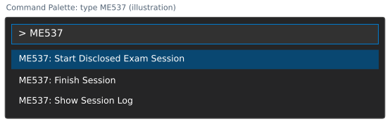

# First: open this README in VS Code's Markdown preview

1. In VS Code, choose **File > Open File...** and select this `README.md`.
2. Click inside the opened file, then use the shortcut for your operating system:

   | Operating system | Open Markdown preview |
   | --- | --- |
   | Windows | **Ctrl+Shift+V** |
   | Linux | **Ctrl+Shift+V** |
   | macOS | **Cmd+Shift+V** |

3. If the shortcut does not work, right-click the file's editor tab and choose
   **Open Preview**. VS Code includes Markdown preview; no extra extension is needed.

These are editor actions, not terminal commands.
[VS Code preview instructions](https://code.visualstudio.com/docs/languages/markdown#_markdown-preview).

# ME 537: Part 2 exam

**Complete and submit Part 1 before starting Part 2.**

Use your **own completed homework library** and the Python virtual environment. Follow the written exam for the task, permitted resources,
explanations, and grading criteria. AI tools and generative completion are
prohibited. 

Follow the **same six steps used in the practice setup**. The final submission is
**`exam.zip`**, created in Step 6.

Use **`part2_exam_files/library_check.zip`** for the setup check,
**`part2_exam_files/results/`** for saved motion, and
**`part2_exam_files/exam.zip`** for submission. During practice, these same file names ended in
`_practice`. Upload the completed exam ZIP for this exam.

Returning to this the exam? See [Taking a break and restarting VS Code](#taking-a-break-and-restarting-vs-code).

## 1. Prepare your working copy

1. Use **your own completed homework repository**. You can reuse the repository
   from the practice setup if you ran the cleanup command. If you followed the steps to "practice" the setup in the same repository, make sure to finish the practice README's Step 6
   export and cleanup **before adding the exam files below**. This preserves
   the practice ZIP and removes the practice recording and demo. Do NOT run
   practice cleanup AFTER starting the exam.
2. Extract **`part2_exam_files.zip` to `part2_exam_files/` inside this repository**.
   On Windows, right-click the ZIP, choose **Extract All...**, and set the
   destination to `your_repository\part2_exam_files`. On macOS or Linux, extract
   to a folder named `part2_exam_files`, then place it beside `src/`.
   Check that this `README.md` is directly inside `part2_exam_files/`.
   Keep it and `images/` there so the instructions display correctly and your
   repository's existing `README.md` is preserved.
3. **Keep all exam files inside `part2_exam_files/`.** Work directly on
   `part2_exam_files/exam_robot.py` and `part2_exam_files/submission.py`.
   Your folder layout should look like this:

   ```text
   your_repository/
     src/
       byu_robomanip/
     part2_exam_files/
       README.md
       images/
       exam_robot.py
       submission.py
       public_case.json
       preflight.py
       replay.py
       package_submission.py
       prepare_vscode.py
       check_environment.py
       ...
   ```

   Your explanation, dependency notes, additional exam helpers, saved results,
   recording, and submission ZIP also belong inside `part2_exam_files/`.
   The supplied setup and export tools use your homework library in `src/`.

4. Open a terminal in the **repository root**, containing `src/` and
   `part2_exam_files/`. Run all terminal commands below from this folder.
5. Activate the Python virtual environment you use for homework. In this guide, `python` means
   that interpreter; use `python3` instead if that is its command on your system.
   Quote paths that contain spaces.

**You are ready when:** `src/` and `part2_exam_files/` are beside each other, your exam files are inside `part2_exam_files/`, and your virtual environment is active.

## 2. Check your Python environment and library

Use the same setup check as practice:

```sh
python part2_exam_files/check_environment.py --repo . --export part2_exam_files/library_check.zip
```

**Expected:** `PASS` messages followed by `RESULT: PASS`. Open
**`part2_exam_files/library_check_summary.txt`** beside the ZIP and verify the printed Python
path points to the Python interpreter in your virtual environment. This checks your library files  and future capability for exporting your files for submission; it
does not run your exam solution or grade numerical accuracy.

If the ZIP already exists, keep it and use a new name such as
`--export part2_exam_files/library_check_2.zip`. Preserve error output and contact the instructor
about setup problems. **This library-check ZIP is not the exam submission.**

## 3. Open the ME537 VS Code environment

If the instructor requires the tested recorder, run the setup command below.
It uses the same separate environment as practice. This command omits
`--practice-demo` because you are working on the exam now.

```sh
python part2_exam_files/prepare_vscode.py --repo . --vsix part2_exam_files/me537-exam-recorder.vsix --launch
```

**Expected:** installation checks pass and a **new ME537 VS Code window** opens.
Use it for Steps 4-6.

<details>
<summary>Only if setup cannot find VS Code or the ME537 window does not appear</summary>

Setup checks for `code` on PATH and, on macOS, inside the standard Applications
folders. If VS Code is installed elsewhere, give setup its launcher path.
For a Mac with VS Code in `/Applications`, the complete command is:

```sh
python part2_exam_files/prepare_vscode.py --repo . --vsix part2_exam_files/me537-exam-recorder.vsix --launch --code "/Applications/Visual Studio Code.app/Contents/Resources/app/bin/code"
```

The path ends at the **`code` file inside the app**, rather than the `.app`
folder. Keep the quotes because the path contains spaces. If you need a custom
launcher path, also add the same `--code "PATH"` when reopening or checking this
environment; setup prints a reopening command that includes it.

Alternatively, open VS Code, press **Cmd+Shift+P**, and run
**Shell Command: Install 'code' command in PATH**. Open a new terminal and repeat
the setup command at the start of Step 3.

**On macOS, a launch request is accepted but no window is visible:** press
**Control+Up Arrow** for Mission Control and check the other desktops for the
ME537 workspace. If it is still missing, open **macOS Terminal or iTerm**,
change to your homework repository folder, activate your homework virtual
environment, and run this reopening command:

```sh
python part2_exam_files/prepare_vscode.py --repo . --launch --code "/Applications/Visual Studio Code.app/Contents/Resources/app/bin/code"
```

If your repository path is long, setup prints a shorter macOS VS Code user-data
directory under `~/.me537/`. Keep using the setup command to reopen the same
environment. The workspace, extensions, exam files, and recordings remain in
your repository.

Setup reports launcher errors. A successful launch request still needs your
visual check: use the ME537 workspace window and confirm its recorder controls.

</details>

**If VS Code shows Restricted Mode:** click **Restricted Mode** at the bottom
of the window, then click **Trust** for this repository folder. This allows
Python debugging and the ME537 recorder to run. The folder is your local homework
repository containing `src/` and `part2_exam_files/`. If Restricted Mode is not
shown, continue below.

Setup prints the Python interpreter it selected. Make sure it points to the
**Python interpreter in the virtual environment you use for homework**.
**If the path is correct, continue to Step 4.**

<details>
<summary>Only if the Python interpreter is wrong or Python commands fail</summary>

Use these troubleshooting steps only if needed:

1. Find the Python interpreter in your homework virtual environment. For a
   virtual environment named `.venv`, typical paths are:

   | Operating system | Python interpreter inside the virtual environment |
   | --- | --- |
   | Windows | `.venv\Scripts\python.exe` |
   | Linux | `.venv/bin/python` |
   | macOS | `.venv/bin/python` |

   Your environment may have a different folder name.

   **Only if setup selected the wrong interpreter**, replace
   `PATH_TO_YOUR_VENV_PYTHON` below with the full path to the Python interpreter
   in your virtual environment, then rerun this complete command:

   ```sh
   python part2_exam_files/prepare_vscode.py --repo . --vsix part2_exam_files/me537-exam-recorder.vsix --python "PATH_TO_YOUR_VENV_PYTHON" --launch
   ```

   **If setup printed the correct interpreter path, skip this command** and
   continue to item 2 below.
2. In the new window, open the Command Palette (**Ctrl+Shift+P** on Windows/Linux;
   **Cmd+Shift+P** on macOS). Select **Python: Select Interpreter** and choose the
   **Python interpreter in your virtual environment**.
3. Close old terminals and choose **Terminal > New Terminal**. Run:

   ```sh
   python -c "import sys; print(sys.executable)"
   ```

   **Expected:** the path points to the Python interpreter in your virtual environment.

</details>

Python Run/Debug controls appear with a `.py` file open.

If setup or the recorder commands are missing, check installation with:

```sh
python part2_exam_files/prepare_vscode.py --repo . --check
```

Keep any error output and contact the instructor if the check fails.

Python packages use the homework virtual environment selected above. Python
packages and VS Code extensions (editor add-ons) are installed separately.

If recording is not required, follow the instructor's announced editor setup
and still verify your Python interpreter before continuing.

## 4. Start recording and edit your work

**This step includes writing your exam solution.** Start recording first since it
is required; then implement and save your method before moving to Step 5 to test it.

**Make sure to start recording before editing any exam work:**

The illustrations below show the controls to look for. Your theme and layout may differ.

1. Check the bottom status bar says **ME537 recorder: OFF**.

   

2. Open the Command Palette (**Ctrl+Shift+P** on Windows/Linux;
   **Cmd+Shift+P** on macOS). Type **ME537** to find the recorder commands.

   

3. Select **ME537: Start Disclosed Exam Session** and read the disclosure.

   

   Choose **Start recording** to accept. **Expected:** the status changes to **ON**.
   Recording starts only after consent.

   

These are Command Palette actions, not terminal commands. If the commands/status
are missing, preserve the error information and contact the instructor.

### Implement your method now

1. Derive the robot's DH table from the **Part 2 drawing below** and the written
   exam. Enter your table in **`part2_exam_files/exam_robot.py`**, replacing `dh = None`. The drawing
   is the same as Problem 3 of Part 1 and is common to everyone.
2. Save and run **`exam_robot.py`**, using VS Code's **Run Python File** button
   or `python part2_exam_files/exam_robot.py` in the terminal. It creates `arm = kin.SerialArm(dh)`
   and shows the robot at zero joint angles. Check it matches the drawing, then
   close the viewer. You can do this before implementing your method.
   If Python says **No module named byu_robomanip**, install your own working
   copy into your active virtual environment with `python -m pip install -e .`
   from the repository root, then run the file again.
3. Open **`part2_exam_files/submission.py`**. Implement
   **`compute_robot_path(...)`** at the marked **`TODO`**, using `arm` and your
   own homework library. Store the joint configurations in **`q_s`** and return
   that list, as in the original exam starter. The first configuration must
   equal `q_init`. The supplied empty list is only a placeholder.
4. **Save `exam_robot.py`, `submission.py`** and any helper files. Then go to **Step 5** to run
   and test your implementation.

Keep recording **ON** while implementing and testing, if recording is required.
You can return here to revise your method and repeat Step 5 as needed. You can stop the 537 recording in **Step 6**, after your code, explanation, and dependency notes
are ready.

Complete the following files as you develop and test your solution:

| File/location | Your required action |
| --- | --- |
| `part2_exam_files/exam_robot.py` | Enter your derived `dh` table; the supplied line creates `arm` |
| `part2_exam_files/submission.py` | Implement `compute_robot_path` using your own homework library |
| `src/byu_robomanip/` | Include your own Python library |
| `part2_exam_files/exam_helpers/` | Put additional Python helpers here, if needed |
| `part2_exam_files/explanation.txt` | Write the explanation and diagnostics required by the written exam |
| `part2_exam_files/dependencies.txt` | Identify external code/sources and any additional dependencies, or state none |
| `part2_exam_files/requirements-extra.txt` | List any additional installed distribution names, one per line |

Keep the supplied function name and arguments. Your function in `submission.py` should return a **list of joint
configurations**, or a NumPy array with one configuration per row. Include
`q_init` first and all of your robot's joints in every configuration. Follow
the written exam's step, tolerance, and collision requirements. Keep your
plotting and test values in the supplied `if __name__ == "__main__":` block;
it runs when you press Run, and the instructor can import your method without
opening a viewer. Keep **`public_case.json` unchanged**.

### Robot drawing and optional added joints

Remember that you may add **up to two joints** while retaining the shown original configuration of the
arm at q=0. Describe added joints in your explanation.
For the original four-joint robot, the supplied `arm = kin.SerialArm(dh)` line
is all you need.

<details>
<summary>If you add joints ...</summary>

Add the corresponding rows to `dh`. For all revolute joints, keep
`arm = kin.SerialArm(dh)`. If you add a prismatic joint, pass a `jt` list to
`SerialArm` with one `"r"` or `"p"` per row, as in your homework library.

If you insert joints between the original four joints, add an
`original_joints` list in `exam_robot.py` identifying the original four DH rows
in order, counting from zero. For example, inserting one extra joint after
the first joint requires `original_joints = [0, 2, 3, 4]`.
If extra joints follow the original four, you do not need this list.

The supplied runner puts each case's four original angles in those rows and
starts extra coordinates at zero. Your function receives all 4, 5 or 6 joint
coordinates; return that many values per configuration. Use radians for
revolute joints and meters for prismatic joints. The instructor reviews your
model and motion.

</details>

<details>
<summary>If your method needs additional data files or packages ...</summary>

Inside `part2_exam_files/`, put additional data under `exam_assets/` and
declare it in `submission_files.json`, for example:

```json
{"assets": ["exam_assets/settings.json"]}
```

Only explicitly declared `.json`, `.txt`, `.csv`, `.npy`, and `.npz` assets are
included. Load them relative to your source file. Dependency declarations accept
distribution names, not pip commands, URLs, or local paths. Nonstandard dependencies
need a tested grading arrangement with the instructor.

</details>

### Taking a break and restarting VS Code

**Breaks and restarts are allowed during practice and Part 2.** Use the same
working copy each time, keeping its `part2_exam_files/exam_session/` folder in place.

1. **Before a planned break:** save all files, then open the Command Palette
   (**Ctrl+Shift+P** on Windows/Linux; **Cmd+Shift+P** on macOS) and select
   **ME537: Finish Session**. Check **FINISHED**, then close the ME537 window.
   You can start another recording when you return.
2. **To reopen:** open a terminal in the **same repository root**, activate
   your homework virtual environment, and run:

   ```sh
   python part2_exam_files/prepare_vscode.py --repo . --launch
   ```

3. **Before continuing any edits:** the reopened recorder starts **OFF**.
   In the new ME537 window, open the Command Palette and select
   **ME537: Start Disclosed Exam Session**. Accept the disclosure and check
   **ON**, then continue your work in Steps 4-5.

Each start adds a new recording segment. Earlier saved events and snapshots
are kept and included together in your final ZIP. Reopening the window does
not start recording automatically. Finish the last recording before exporting
in Step 6.

**If the window closes unexpectedly:** reopen it with the command above and
start recording again before editing. Keep the existing `part2_exam_files/exam_session/` folder;
earlier saved records remain available for instructor review. You can resume
even if you did not select Finish Session before the window closed.


## 5. Run and review the saved motion

**Test the method you implemented and saved in Step 4.** Run **`submission.py`**
with VS Code's **Run Python File** button, or use:

```sh
python part2_exam_files/submission.py
```

**Expected:** the viewer shows your robot, the goal and obstacle, then plays
the configurations returned by your method. Close the viewer when finished.
The test values are at the bottom of `submission.py`; you can change them
and rerun the file to test other cases. The instructor will also test other cases.

Entering your DH table is required before either preview will run. An empty
`q_s` produces a **No path returned** message; implement your method first.

The goal of the next command is to make sure your output is ready for final submission. This is why the program is called `preflight.py`. We run it as follows:

```sh
python -B part2_exam_files/preflight.py --root . --case part2_exam_files/public_case.json --output part2_exam_files/results/trajectory.npy
```

**Expected:** the printed status is **`import_and_output_contract_pass`**, and
**`part2_exam_files/results/trajectory.npy`** is saved. Preflight checks imports, output shape, finite
values, and the number of rows. It has a 60-second timeout.
It also records the initial configuration and largest joint change. Any
**`review_flags` are notes for review: they do not prevent saving your trajectory
or submitting your ZIP.** Your returned trajectory is saved unchanged.
It does **not** check reaching the goal or avoiding collisions; evaluate those
requirements and explain your diagnostics as directed by the written exam.

<details>
<summary>If preflight reports motion review flags</summary>

The checker compares your first returned row with the **original `q_init`**
provided to your function. Its report shows both values if they differ.
Check that you have not reset `q_s` after saving the initial configuration.

Appending a NumPy array to a list does not make a copy. If you later change
that array, the saved row changes too. Save the initial configuration with
`q_s.append(q_init.copy())`, use `q = q_init.copy()` for your working
configuration, and save subsequent configurations with `q_s.append(q.copy())`.
This also keeps earlier rows from changing as your method runs.

A large change between consecutive configurations is also recorded for instructor
review. If this is a concern, reduce your allowed step size. The tool's review threshold is **not a pass/fail limit**.
Neither flag stops saving, replay, or submission. These notes help you review
your work; follow the requirements in the written exam. The exporter includes
the notes with your unchanged trajectory for instructor review.

</details>

<details>
<summary>Optional: view a saved result without running your method again</summary>

```sh
python part2_exam_files/replay.py --root . --trajectory part2_exam_files/results/trajectory.npy --case part2_exam_files/public_case.json
```

**Expected:** the viewer plays your saved trajectory with the case markers.
Replay only displays the saved data; it does not rerun your method or create a
results folder. To test changes to your method, rerun **preflight** instead.
The instructor later reruns cases and renders review movies using the submitted
numerical model and trajectory. The instructor also reviews whether the model
represents the required robot; the viewer alone does not establish correctness.

</details>

<details>
<summary>Optional: change the case used by the supplied check</summary>

For another test case, create a separate JSON file and pass its path with
`--case`. Use these fields and preserve the supplied public case:

| Field | Meaning |
| --- | --- |
| `q_init` | Four original joint increments in radians; added coordinates start at zero |
| `goal` | Three Cartesian coordinates in meters, frame 0 |
| `obst_location` | Three Cartesian coordinates in meters, frame 0 |
| `obst_radius` | Positive radius in meters |

</details>

If testing shows that you need changes, return to the implementation section in
**Step 4**, save your changes, and repeat **Step 5**. Keep recording active during
this work. Finish your explanation, dependency notes, and declared
assets **before Step 6**.

## 6. Finish recording and export your ZIP

1. **Save all work**, including your explanation of your approach and functionality in `explanation.txt` and any other necessary dependency files.
2. Select **ME537: Finish Session** from the Command
   Palette. **Expected:** the status says **FINISHED**.
3. Export the packet for submission from a terminal in your repository root. The arguments are defined here to help you better understand their purpose:

   | Argument | What it selects |
   | --- | --- |
   | `--root .` | Your homework repository, containing `src/` and `part2_exam_files/`; `.` means the current folder |
   | `--case CASE.json` | The input case the exporter uses to rerun your method and check the packaged code |
   | `--output NAME.zip` | The new submission ZIP file to create; choose a name that does not already exist |

   **Example:** use the supplied **`public_case.json`** and create a ZIP named
   **`exam.zip`** with:

   ```sh
   python part2_exam_files/package_submission.py --root . --case part2_exam_files/public_case.json --output part2_exam_files/exam.zip
   ```

4. Read the output. It prints the preflight status, ZIP file list, and
   **FINAL RECORDING / SUBMISSION CHECK**. When recording was required, check for
   **`MATCH`**. `MISMATCH` lists changed, added, or missing files. `INCOMPLETE`,
   `UNVERIFIABLE`, or `NOT_RECORDED` identifies a recording review issue; preserve
   the evidence and contact the instructor under the announced recording policy.
5. Check the printed ZIP file list for your solution/library/helpers,
   explanations, declared assets, environment report, local results, and
   recording files when recording was required. The exporter includes the
   session log automatically for your instructor; **you do not need to open or
   inspect it**. The instructor independently reruns the file comparison and
   your code.
6. **Upload `exam.zip` from `part2_exam_files/` on Learning Suite. Uploading this ZIP is required to
   receive a score and grade for Part 2.** Keep your working copy and local
   reports. Submit this completed exam ZIP, not a practice ZIP or your virtual
   environment.

Existing ZIPs are preserved: choose `part2_exam_files/exam_2.zip` for a later export. If further
edits are needed, start a **new disclosed session before editing**, finish again,
and create a new ZIP. Do not edit files inside an exported ZIP.

An active unfinished session or missing required file must be resolved before
export. A failed solution/preflight is recorded and still permits a ZIP for
partial credit. Read the report and follow the written exam's incomplete-work
instructions. A recording discrepancy flags review and does not prevent ZIP creation.

## What recording and export collect

During a session, the recorder saves source-code copies, edit/save times and
sizes, session activity, VS Code focus changes, and extension information in
`part2_exam_files/exam_session/`. Finishing records file fingerprints for your code, model,
explanations, dependency notes, and declared data so they can be compared with
the files you submit.

The export automatically bundles your solution, own library, helpers, notes,
declared data, dependency versions, test results, and recording files for your
instructor's review. Preserve these files and contact the instructor if a tool fails.
